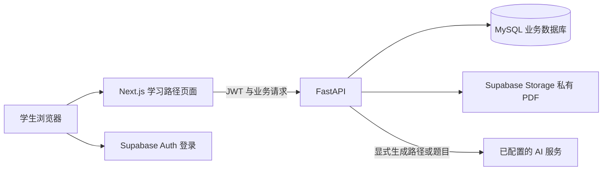

# CourseHub — AI 个性化学习路径使用与交接说明

更新日期：2026-11-13。对应当前已实现的基础版本，供本地运行、小组演示与后续交接使用。

本文只说明学习路径模块，不替换其他成员的课程、选课、账号治理和部署文档。仓库中的部分 README
保留了早期开发状态；本模块的运行方式、迁移和功能边界以本文及下面的专项说明为准。

| 文档 | 用途 |
|---|---|
| 本文 | 中文运行步骤、使用流程、演示清单和交接入口 |
| [后端技术说明（英文）](../backend/LEARNING_PATHS.md) | 生成、阅读、测验、调整、权限、接口与实现限制 |
| [验收记录](../backend/LEARNING_PATH_ACCEPTANCE.md) | 自动化与真实浏览器分别验证了什么、哪些部分仍需补充 |
| [项目中文 README](../README.zh.md) | 原系统的角色、课程、选课、环境和部署说明 |

---

## 1. 当前版本实现了什么

学生可以保存学习目标，调用真实 AI 生成学习路径，在路径中进入任务学习，完成阶段测验，
再根据成绩查看并确认复习建议。目标版本、任务进度、测验轮次、成绩和调整记录保存到数据库。

| 能力 | 当前行为 |
|---|---|
| 学习目标 | 主题、目标、当前水平、总时间预算、可选的关联课程；支持多个计划和目标版本 |
| 路径生成 | 显式点击后调用真实 AI，校验任务、总时长和资料来源，再整体保存 |
| 在路径中学习 | 有来源的任务显示对应 PDF 页码正文；独立练习显示任务说明 |
| 完成记录 | 学生手动确认学完，可撤销；打开页面或翻页不会自动完成任务 |
| 阶段测验 | 每阶段五道单选题，后端评分，4/5 及以上达标；不计入正式课程成绩 |
| 新一轮测验 | 学完本阶段并提交当前轮次后，确认调用 AI 生成新题；旧题、解析和成绩保留 |
| 学习调整 | 根据成绩采用固定规则提出复习、练习或挑战任务，先预览，确认后应用 |
| 计划完成 | 全部任务完成，且每阶段最新一轮的最近成绩至少为 4/5 |
| 权限与历史 | 每个学生只能访问自己的计划；旧目标版本只读，课件仍受原选课权限控制 |

课程自动推荐、跨课程自动规划、外部资源推荐尚未实现，列为后续扩展。本模块尚未与队友的
“上传 PDF 自动生成课程”功能完成联调；目前复用系统已有的课程和课件数据。

## 2. 运行时各部分的关系



- `frontend/` 和 `backend/` 是实际运行系统；`demo/` 是模拟数据原型，不用于验证真实保存和 API 调用。
- MySQL 保存业务数据。Supabase 仍负责当前实现中的认证和文件存储，两者不是同一个配置。
- 浏览器不直连 MySQL。AI 密钥、数据库密码和 Supabase `service_role` 密钥只放后端。

## 3. 本地配置与启动

### 3.1 准备依赖

需要 Node.js 18.18+、npm、Python 3.12+，以及可访问的 MySQL、Supabase Auth 和 Storage。
后端依赖以 [requirements.txt](../backend/requirements.txt) 为准，包含 PDF 文字提取所需的 `pypdf`。

以下命令假设从项目根目录打开终端。若已按团队方式安装依赖、使用 Conda 或已有 `.venv`，
继续使用原环境，不必重复创建环境。

```powershell
# 后端：只在没有虚拟环境时创建
cd backend
py -3.12 -m venv .venv
.\.venv\Scripts\python.exe -m pip install -r requirements.txt
```

另开一个从项目根目录开始的终端：

```powershell
cd frontend
npm.cmd install
```

这里使用 `npm.cmd`，可避开部分 PowerShell 脚本执行策略或命令别名问题。

### 3.2 放置配置文件

| 文件 | 放什么 | 示例 |
|---|---|---|
| `backend/.env` | MySQL、Supabase 服务端配置、AI 配置、CORS | [backend/.env.example](../backend/.env.example) |
| `frontend/.env.local` | Supabase 浏览器端配置、FastAPI 地址 | [frontend/.env.example](../frontend/.env.example) |

文件名是 `.env` 和 `.env.local`，不是 `.evn`；还要检查是否被 Windows 隐藏扩展名变成了 `.txt`。
队友已经提供配置时，确认字段与环境一致即可，不要直接用示例覆盖已有文件。没有配置文件时才从示例复制。

队友提供的主机、端口、用户名、密码和数据库名，用于组成后端的 `DATABASE_URL`：

```dotenv
DATABASE_URL=mysql+pymysql://<username>:<URL-encoded-password>@<host>:3306/<database>
```

密码中的特殊字符需要 URL 编码，例如 `@` 写为 `%40`。如果使用的是已建好表的小组共享数据库，
本地只运行前后端，不必另装或启动一份 MySQL，也不要自行更换连接目标。

后端还需要 `SUPABASE_URL`、`SUPABASE_SERVICE_ROLE_KEY`，以及与项目签名方式匹配的 JWT 配置。
前端使用 `NEXT_PUBLIC_SUPABASE_URL`、`NEXT_PUBLIC_SUPABASE_ANON_KEY` 和
`NEXT_PUBLIC_API_BASE=http://127.0.0.1:8000`。完整字段见各自的示例文件。

真实密码和密钥不要写入说明文档、示例文件、截图或 Git。`AI_API_KEY` 和 `service_role` 密钥
不能放入任何 `NEXT_PUBLIC_*` 变量。

### 3.3 配置 AI

只在 `backend/.env` 中增加或填写：

```dotenv
AI_GENERATION_ENABLED=true
AI_CHAT_COMPLETIONS_URL=https://<provider-host>/v1/chat/completions
AI_API_KEY=<your-server-side-key>
AI_MODEL=<provider-model-id>
AI_TIMEOUT_SECONDS=120
```

服务需兼容当前适配器使用的 Chat Completions 消息、JSON 输出和 `max_tokens` 参数。
地址要包含完整接口路径；OpenRouter 对应 `https://openrouter.ai/api/v1/chat/completions`。
模型 ID 使用账号实际可用的模型；模型可用性与调用额度需要在服务商后台确认，本文不承诺免费额度或响应时间。

未配置 AI 时可以保存草稿、查看已有记录；生成新路径和新题需要可用配置。
普通查看、评分和规则式调整不调用 AI。能力检查只能确认配置存在，不代表外部服务一定能成功响应。

### 3.4 核对数据库迁移

启动应用不会自动建学习路径表。请先由数据库负责人核对已应用的迁移；不要为了运行本功能，
在共享数据库上重复执行初始化、种子数据或旧 Supabase 迁移脚本。

| 顺序 | 迁移 | 作用 |
|---|---|---|
| 001 | [001_learning_paths.sql](../backend/db/migrations/001_learning_paths.sql) | 新增计划、目标版本、学习任务三张表 |
| 002 | [002_learning_path_task_sources.sql](../backend/db/migrations/002_learning_path_task_sources.sql) | 新增任务与课件页码、指纹的关联表 |
| 003 | [003_learning_path_assessments.sql](../backend/db/migrations/003_learning_path_assessments.sql) | 新增测验与作答记录两张表 |
| 004 | [004_learning_path_adjustments.sql](../backend/db/migrations/004_learning_path_adjustments.sql) | 新增调整记录表 |
| 005 | [005_learning_path_quiz_rounds.sql](../backend/db/migrations/005_learning_path_quiz_rounds.sql) | 只调整测验表索引，使同一阶段可保存多轮测验 |

001–004 共增加七张本模块数据表。005 保留原题目、成绩和外键，不增加表或字段，但只能在核对结构后执行一次，
不能当作每次启动命令。2026-11-13 验收所用共享数据库已应用 001–005；其他数据库需要单独核对。

### 3.5 启动两个服务

下面每段命令都从项目根目录开始；如果终端已经在 `backend` 或 `frontend` 中，省略对应的 `cd` 行即可。

后端终端：

```powershell
cd backend
.\.venv\Scripts\python.exe -m uvicorn app.main:app --reload --port 8000
```

前端终端（另开一个窗口，从项目根目录开始）：

```powershell
cd frontend
npm.cmd run dev
```

- 健康检查：<http://127.0.0.1:8000/health>
- API 文档：<http://127.0.0.1:8000/docs>
- 中文学习路径入口：<http://localhost:3000/zh/learning-path>
- 英文入口：<http://localhost:3000/en/learning-path>

使用学生账号登录；教师和管理员不会使用学生专用的路径接口。保持两个服务终端运行。
修改 `.env` 后重启后端，修改 `.env.local` 后重启前端；生产部署则需重新构建前端。
若更换端口，同时核对 `NEXT_PUBLIC_API_BASE` 和后端 `CORS_ORIGINS`，不要只修改页面地址。

## 4. 操作与演示流程

建议创建带“演示测试”前缀的独立计划，保留原学习记录。新路径和新题会调用 AI，
不需要在展示已有结果时反复生成。

1. 进入“我的学习路径”，填写目标并保存草稿。例如主题“需求分析入门”，目标“区分功能与非功能需求，写出可验证的验收标准”，初学、1 小时。
2. 点击“生成学习路径”，等待校验与保存。失败时查看提示；不要连续重复提交。
3. 点击任务的“去学习”。有课件的任务读取关联页码；无课件任务按照说明练习。
4. 点击“确认学完”，或在路径中勾选任务。阶段内还有任务时继续学习，全部完成后可进入该阶段测验。
5. 生成并提交五道题，查看分数、薄弱概念和解析。首次生成前没有题目，已有题目不会在打开时重新调用 AI。
6. 需要补充学习时，点击“查看学习路径调整建议”，再查看具体预览。核对任务和时长后确认应用；超预算必须另行勾选确认。
7. 应用后阶段列表自动更新，新增任务仍在原阶段中，原完成记录保留。完成复习后可重测原题，也可确认生成新一轮题目。
8. 全部任务完成且每阶段最新一轮最近一次测验达到 4/5，显示“计划已完成”。刷新检查记录是否恢复。

### 调整规则与完成标准

| 最近成绩 | 当前规则 |
|---|---|
| 0–2/5 | 按不同错题知识点增加复习任务，每项 15 分钟 |
| 3/5 | 按不同错题知识点增加针对性练习，每项 20 分钟 |
| 4–5/5 | 本阶段任务都完成时可建议一项 30 分钟挑战；否则先完成当前任务 |

调整采用固定规则，不是额外调用 AI 重写后续课程。为尽量容纳新增任务，只调整未完成的后续阶段任务时长，
每次最多缩短一半并保留至少五分钟，不删除后续教学内容。仍超预算时明确显示增加的时间，原预算不被覆盖。

“任务进度 100%”不等于“计划已完成”。新增复习任务后百分比可能下降；撤销完成、最近测验未通过，
或成功生成了尚未通过的新轮次，也可能使计划重新变为未完成。这些是按当前记录计算的结果。

同一轮重测使用相同题目，新一轮使用独立题目并保留历史；看过解析后的高分不能证明首次掌握。
历史目标版本和旧测验轮次只读。后续阶段可以浏览，目前没有强制逐阶段解锁。

## 5. 测试与交接检查

后端（从项目根目录开始）：

```powershell
cd backend
.\.venv\Scripts\python.exe -m pytest -q -p no:cacheprovider
```

前端（另一个从项目根目录开始的终端）：

```powershell
cd frontend
npm.cmd run typecheck
npm.cmd run test:learning-path
```

文档链接（项目根目录）：

```powershell
node scripts/check-docs.mjs
```

自动化测试使用隔离数据和模拟 AI，不调用真实服务或写入共享数据库。最新已记录的结果、真实验证范围及
独立测试计划见[验收记录](../backend/LEARNING_PATH_ACCEPTANCE.md)。测试数量随开发变化，不以旧 README 中的数量判断当前结果。

合并到小组版本后，再人工快速回归：学生登录与退出、课程目录、课程详情、选课申请、获批后的 PDF 预览，
以及教师和管理员已有的页面。自动化测试通过不等于所有角色的生产环境检查都已完成。

## 6. 常见问题与已知边界

| 现象 | 先检查什么 |
|---|---|
| 页面能打开，但无法连接后端 | 后端终端是否仍运行、8000 端口、前端 API 地址、CORS；前端和后端都需启动 |
| MySQL 连接失败 | 后端 `DATABASE_URL`、账号权限、网络放行、密码编码；不要把连接串发到聊天或提交到 Git |
| 提示需要迁移 | 由数据库负责人核对对应 001–005 迁移，不要重新初始化共享库 |
| 提示 AI 未配置 | 检查后端 AI 字段并重启；只有字段齐全仍不能保证服务可达或额度充足 |
| AI 限流、超时或请求失败 | 查看错误提示与服务商状态，保留草稿后稍后重试；不要把失败归因于某一种网络或额度问题而不核实 |
| 查看成绩或提交较慢 | 这些操作不调用 AI，但仍访问远程 MySQL、校验资料并下载关联 PDF；生成新题还额外等待 AI |
| 无法读取课件 | 关联课程、发布状态、选课审批和文件是否仍存在；路径不会授予额外访问权限 |
| 提示来源已更改 | PDF 指纹和原生成资料不一致，需要重新核对资料，不能静默把任务指向新文件 |
| 图片、公式或扫描页没有提取文字 | 当前只提取 PDF 文字，不包含 OCR；可查看原始 PDF，但不能声称 AI 已理解其中图片 |

当前路径生成最多读取前三份课件、合计十二个完整页面与两万字符；阶段出题最多读取十个关联页面与一万二千字符。
这是部分资料依据，不是整门课程的完整知识点检索。当前演示数据中的最小 PDF 可测试预览和定位，不能代替正文完整的教学课件。

## 7. 主要代码位置

| 文件 | 职责 |
|---|---|
| [LearningPaths.tsx](../frontend/components/LearningPaths.tsx) | 计划列表、目标表单、版本、进度与刷新 |
| [LearningPathStages.tsx](../frontend/components/LearningPathStages.tsx) | 按阶段排列任务与测验 |
| [MaterialReader.tsx](../frontend/components/MaterialReader.tsx) | 阅读正文、手动完成与继续学习入口 |
| [StageQuiz.tsx](../frontend/components/StageQuiz.tsx) | 出题、提交、轮次切换、成绩和解析 |
| [LearningAdjustment.tsx](../frontend/components/LearningAdjustment.tsx) | 调整预览、额外时间确认、应用 |
| [LearningPathCompletion.tsx](../frontend/components/LearningPathCompletion.tsx) | 单独展示计划完成状态与阶段通过数 |
| [learning_paths.py](../backend/app/learning_paths.py) | 计划、目标版本、任务进度与资源接口 |
| [plan_generation.py](../backend/app/plan_generation.py) | AI 适配、资料上下文和原子保存 |
| [learning_task_reading.py](../backend/app/learning_task_reading.py) | 任务到课件页码的读取与来源检查 |
| [learning_assessments.py](../backend/app/learning_assessments.py) | 阶段测验、多轮题目、评分和历史 |
| [learning_adjustments.py](../backend/app/learning_adjustments.py) | 规则式调整与确认应用 |
| [learning_progress.py](../backend/app/learning_progress.py) | 统一计算阶段和计划完成条件 |
| [learning_schema.py](../backend/app/learning_schema.py) | 单次请求内复用数据库结构查询 |
| [models.py](../backend/app/models.py) | 共享模型文件；本模块模型以 `LearningPath` 开头 |
| [连续流程测试](../backend/tests/test_learning_path_acceptance.py) | 从草稿到完成、调整、轮次与历史保护的隔离测试 |

后续与课程生成功能对接时，先约定课程 ID、课件 ID、正文页码、发布状态和访问权限，
继续复用已有课程与选课接口；不要在学习路径中绕过审批或自行改动他人页面。
